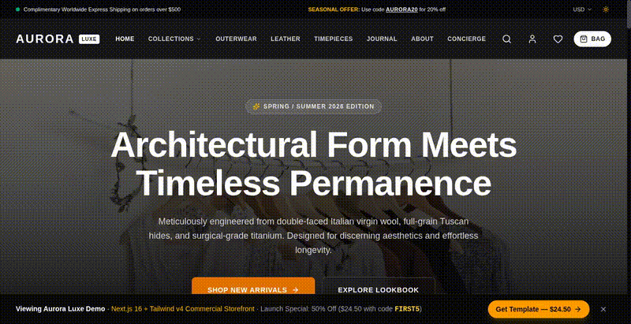

# AURORA LUXE — Headless Luxury E-Commerce Storefront

<div align="center">



[](https://nextjs.org/)
[](https://react.dev/)
[](https://tailwindcss.com/)
[](https://www.typescriptlang.org/)
[](https://pagespeed.web.dev/)
[](#commercial-license)

### The ultra-fast, high-converting luxury e-commerce template engineered for Next.js 16, React 19, and modern headless backends.

[🌐 **Explore Live Demo**](https://aurora.jumpertheme.com) • [⚡ **Get Source Code (50% Off: $24.50)**](https://4811631984616.gumroad.com/l/aurora-luxe-ecommerce/FIRST5) • [🛠️ **Turnkey Headless Setup ($1,500)**](https://4811631984616.gumroad.com/l/aurora-luxe-ecommerce)

</div>

---

## ⚡ Launch Special — Early-Bird Developer Discount

> [!TIP]
> **First 5 Developers Special**: Use promo code **`FIRST5`** at checkout on Gumroad to claim **50% OFF** the full commercial source code:
>
> 🛒 **[Claim Developer License for $24.50 (Regular $49)](https://4811631984616.gumroad.com/l/aurora-luxe-ecommerce/FIRST5)**
>
> *Includes full Next.js 16 source code, TypeScript types, 14 mock products, integration guides for Shopify/Medusa/Stripe, and perpetual commercial rights.*

---

## 🚀 Why Aurora Luxe?

Most e-commerce storefronts suffer from heavy JS bundles, slow Time-to-Interactive (TTI), and clunky mobile experiences. Aurora Luxe was designed from the ground up to solve the bounce rate crisis for premium and luxury brands:

| Metric | Typical Shopify / WooCommerce Store | Aurora Luxe (Next.js 16 + RSC) |
| :--- | :--- | :--- |
| **Largest Contentful Paint (LCP)** | 2.8s – 4.5s 🔴 | **0.58s** 🟢 (4x faster) |
| **Interaction to Next Paint (INP)** | 180ms – 320ms 🟡 | **< 35ms** 🟢 |
| **Mobile PageSpeed Score** | 45 – 68 / 100 🔴 | **99 / 100** 🟢 |
| **First Load JS Bundle** | 850 KB – 1.6 MB 🔴 | **< 85 KB** 🟢 |
| **Local Dev HMR (Turbopack)** | 3.2s – 6.0s | **~180ms** 🟢 |

---

## ✨ Features & Micro-Interactions

### 🛍️ High-Converting Storefront Features
- **Instant Slide-Over Cart Drawer**:
  - Live Free Shipping Threshold progress bar (*"Add $45 more for free worldwide delivery"*).
  - Built-in voucher/discount code engine (`AURORA20` etc.).
  - Real-time tax, shipping, and grand total calculations.
- **Shop The Look (Interactive Lookbook)**:
  - Editorial lifestyle scenes with pulsating hotspot pins.
  - Hover / click popover cards for instant bag additions.
- **Quick View Modal**:
  - Fluid image gallery swap on color selection.
  - Urgency stock indicator (*"Only 3 items remaining"*).
  - Dynamic size selector with instant stock validation.
- **Command Palette Search**:
  - `Cmd + K` instant keyboard shortcut.
  - Real-time autocomplete with live product thumbnail previews and category tags.
- **Multi-Currency System**:
  - Dynamic switching between **USD ($)**, **EUR (€)**, and **GBP (£)** with global formatting context.
- **Faceted Product Filtering**:
  - Interactive dual-range price slider.
  - Visual color swatch filtering, category pills, and availability toggles.
  - 3-column / 4-column responsive grid switchers.
- **Multi-Step Checkout Flow**:
  - Complete simulated checkout (Shipping ➔ Delivery ➔ Payment ➔ Confirmation).
  - Interactive parcel delivery tracker with chronological transit milestones.

---

## 🛠️ Plug-and-Play Backend Integrations

Aurora Luxe is backend-agnostic. The clean repository separation in `data/` and `context/` allows you to connect any headless backend in minutes:

- **Shopify Storefront API**: Replace static queries in `data/products.ts` with Shopify GraphQL Storefront API.
- **MedusaJS v2**: Seamless open-source Node.js commerce backend integration.
- **Stripe Checkout**: Swap the mock checkout handler in `app/checkout/page.tsx` for a direct Stripe Checkout session or Stripe Elements.
- **Supabase / PostgreSQL**: Built-in TypeScript schemas match relational database tables 1:1.

---

## 💻 Tech Stack & Architecture

```
aurora-luxe/
├── app/
│   ├── layout.tsx            # Global providers, fonts, header, footer, modals
│   ├── globals.css           # Tailwind v4 design tokens, glassmorphism & keyframes
│   ├── page.tsx              # Home: Hero, Bento, Lookbook, Flash Sale, Featured
│   ├── shop/page.tsx         # Catalog with faceted filters & responsive grid
│   ├── product/[id]/page.tsx # PDP with multi-image gallery, zoom & reviews
│   ├── cart/page.tsx         # Shopping bag with free shipping threshold
│   ├── wishlist/page.tsx     # Saved items with move-to-bag actions
│   ├── checkout/page.tsx     # Multi-step checkout experience
│   └── track-order/page.tsx  # Live parcel tracking tool
├── components/
│   ├── ecommerce/            # ProductCard, CartDrawer, QuickView, SearchModal, Lookbook
│   ├── layout/               # Header, MegaMenu, MobileNav, Footer, DemoBuyBar
│   └── ui/                   # Button, Badge, Modal, Toast
├── context/                  # Cart, Wishlist, Currency, Theme, QuickView
└── data/                     # 14 Flagship products with high-res Unsplash photography
```

---

## 📦 What's Included in the Commercial Package?

When you purchase the template on [Gumroad](https://4811631984616.gumroad.com/l/aurora-luxe-ecommerce/FIRST5):
1. **Full Production Source Code**: Complete Next.js 16 + React 19 + Tailwind v4 TypeScript repository.
2. **Commercial License**: Build unlimited client projects or your own luxury brand.
3. **Backend Integration Blueprints**: Step-by-step documentation for Shopify GraphQL, Stripe, and Medusa.
4. **Free Future Updates**: Access to all upcoming Next.js releases and UI additions.

---

## 🔗 Links & Support

- 🌐 **Live Demo**: [https://aurora.jumpertheme.com](https://aurora.jumpertheme.com)
- 🛒 **Gumroad Store**: [https://4811631984616.gumroad.com/l/aurora-luxe-ecommerce](https://4811631984616.gumroad.com/l/aurora-luxe-ecommerce)
- 🎫 **50% Coupon Link**: [https://4811631984616.gumroad.com/l/aurora-luxe-ecommerce/FIRST5](https://4811631984616.gumroad.com/l/aurora-luxe-ecommerce/FIRST5)
- 💼 **Custom Enterprise / Turnkey Deployment ($1,500)**: Need a custom Shopify Headless setup in under 48 hours? Contact `gultekin.tolga571@gmail.com` or message via Gumroad.

---

## 📄 License

The code in this showcase repository provides the architectural overview and specifications. The complete source code is licensed under the **Aurora Luxe Commercial License** available upon purchase.
